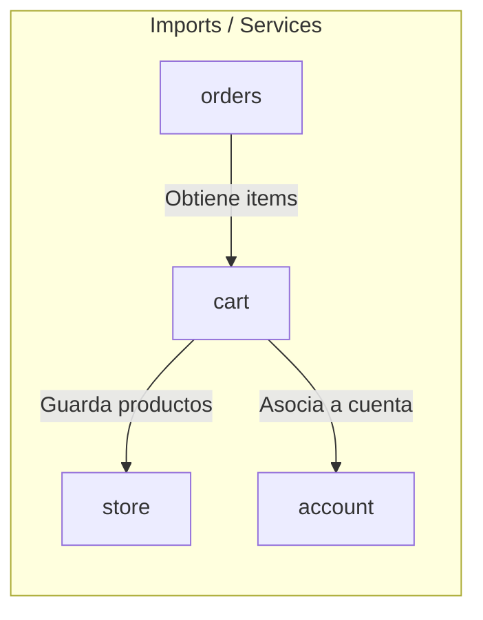

# 📦 Módulo Cart — Cerebro Local

## 🎯 Propósito
Este módulo implementa el carrito de compras del sitio. Gestiona la agregación, actualización y remoción de productos (y sus variaciones), unificando de manera transparente la lógica para visitantes anónimos (basado en sesión) y usuarios autenticados (guardado en BD).

## 🕸️ Grafo de Dependencias (Codebase Graph)

*   **Entidades dependientes de este módulo:** 
    *   [orders](../orders/README.md) (Requiere el contenido del carrito para iniciar el checkout y generar pedidos)
*   **Módulos requeridos por este módulo:** 
    *   [store](../store/README.md) (Define `Product` y `Variation` que se guardan en el carrito)
    *   [account](../account/README.md) (Modela el `Account` al que se asocian las compras)

## 🛠️ Modelos Clave / Entidades (DB)
- **Cart** (Hereda de `models.Model`): Modela el carro de compras para usuarios anónimos a través de un `cart_id` ligado al identificador de la sesión de Django (`session_key`).
- **CartItem** (Hereda de `models.Model`): Vincula los productos agregados al carro. Soporta ForeignKey a `Account` (usuario autenticado), ForeignKey a `Cart` (usuario anónimo), ForeignKey a `Product`, cantidad, variación elegida (`Variation` Many-to-Many) y el precio de compra en el momento de agregado (`purchase_price` como `DecimalField(max_digits=12, decimal_places=2)` congelado).

## ⚡ Servicios y Casos de Uso Críticos (services.py)
- **CartService.get_or_create_cart_id**: Inicializa u obtiene de forma segura la sesión del visitante para identificar su carrito.
- **CartService.get_cart_items**: Recupera los items del carro activos. Si el usuario está logueado, prioriza la consulta por clave de usuario; de lo contrario, por el ID de sesión.
- **CartService.calculate_cart_totals**: Calcula de manera centralizada la cantidad de artículos y el total del carrito.
- **CartService.add_to_cart**: Añade un producto o incrementa su cantidad. Compara las combinaciones de variaciones existentes para decidir si incrementa un item existente o añade una nueva línea. Aplica validación estricta y clamping defensivo de cantidad `[1, 1000]`.
- **CartService.update_quantity**: Actualiza explícitamente la cantidad de un `CartItem` validando límites comerciales `[1, 1000]` y control de pertenencia (usuario o sesión). No borra ítems silenciosamente ante entradas inválidas (lanza `ValueError`).
- **CartService.remove_from_cart**: Decrementa o remueve completamente un `CartItem`. Resiliente a contextos autenticados (`user_id`) y anónimos (`cart__cart_id`), validando propiedad y previniendo excepciones por desajustes de sesión.
- **CartService.merge_cart_on_login**: Resuelve la conciliación al iniciar sesión. Traspasa los items del carrito anónimo al carrito persistente de la cuenta de usuario, unificando duplicados y limpiando la sesión previa.

## 🌐 Controladores y Vistas Web (web/views/views.py)
- **cart_view**: Renderiza la vista principal del carrito (`cart.html`) con resumen financiero y empty state reactivo.
- **update_cart_quantity**: Endpoint POST dual para actualizar cantidad. Responde con JSON (cadenas decimales formateadas a 2 decimales para precisión contable y estado del carrito) si la petición es AJAX, o con redirección 302 hacia `cart:cart` si proviene de formulario nativo.
- **remove_cart_item**: Endpoint POST dual para eliminación de ítems. Devuelve `{ status: 'deleted', item_id, cart: { total, quantity, item_count, is_empty } }` para sincronización en caliente en el cliente, o 302 al carrito.
- **get_cart_data**: Endpoint AJAX para telemetría y actualización del contador flotante.

## 🎨 Componentes y Frontend Progresivo (Alpine.js)
- **`cartSummary`**: Componente reactivo global para el resumen del pedido (`_order_summary_card.html`), con formateo regional en moneda argentina (`Intl.NumberFormat('es-AR')`) y escucha de eventos `cart-updated`.
- **`cartItemRow`**: Componente de fila/tarjeta con input numérico directo `[1, 1000]`, botones de incremento/decremento (`stepQuantity`), feedback de carga (`Actualizando...`, `Eliminando...`) y reintento.
- **Eliminación Reactiva Sin Fricción**: Resolución robusta del token CSRF directamente desde el DOM del `<form>` emisor, eliminación simultánea en vistas desktop (`_cart_item_row.html`) y mobile (`cart.html`), con fallback automático a `form.submit()` nativo sin JS. Transición fluida a `_empty_cart.html` al vaciar el carrito sin recargas de página.

## 📝 Notas de Detalle (Obsidian Vault)
- **Precio Fijo de Compra (Fase 1C & Hardening)**: Al crearse un `CartItem`, su `purchase_price` se congela según el valor actual (`price` o `sale_price` si está en promoción) utilizando `DecimalField(max_digits=12, decimal_places=2)`. Esto elimina discrepancias de redondeo en flotantes y previene que alteraciones de catálogo afecten compras en curso.
- **Seguridad y Hardening (AppSec - Fases 19, 21 y 26)**:
  - **Mitigación CSRF vía GET (AUD-CART-001)**: Operaciones de mutación de estado (`add_cart`, `update_cart_quantity`, `remove_cart`, `remove_cart_item`) restringidas con `@require_POST`.
  - **Precisión Financiera (AUD-CART-002)**: Migración de `purchase_price` de `FloatField` a `DecimalField(max_digits=12, decimal_places=2)`.
  - **Open Redirect (SEC-103)**: `add_cart` valida `HTTP_REFERER` mediante `url_has_allowed_host_and_scheme(allowed_hosts={request.get_host()})`.
  - **Input Validation y Clamping Centralizado (SEC-108)**: Validación defensiva contra strings no numéricos y restricción estricta de cantidad al rango seguro `[1, 1000]` centralizada en la capa de servicios (`CartService.add_to_cart` y `CartService.update_quantity`).
  - **Control de Acceso y Prevención de IDOR (Fase 26)**: Control estricto de pertenencia en `update_quantity` y `remove_from_cart`. Un usuario autenticado o sesión anónima no puede alterar o eliminar ítems pertenecientes a otros usuarios o sesiones.
  - **Medición Híbrida CAPI AddToCart (Fase 24)**: La vista `add_cart` captura el identificador único `fb_event_id` generado en el cliente (Alpine.js) y despacha de forma desacoplada la tarea asíncrona hacia `MetaCapiService.enqueue_add_to_cart(request, product, quantity, event_id)` para deduplicación 1:1 en Meta Events Manager.
  - **Suite de Pruebas**: Tests unitarios, de integración, regresión y seguridad en `cart/tests/` (`test_services.py`, `test_web.py`, `test_security.py`) con 31 tests específicos pasando limpiamente.

