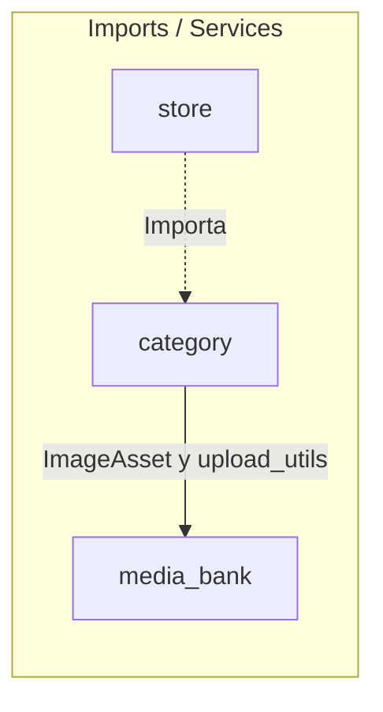

# 📦 Módulo Category — Cerebro Local

> **Mapa neuronal:** **Relacionados:** [store](../store/README.md) · [media_bank](../media_bank/README.md) · [web_bulonera](../web_bulonera/README.md)

## 🎯 Propósito
Este módulo gestiona la jerarquía de categorización de los productos de la tienda online (Categorías y Subcategorías), su optimización SEO semántica y la configuración dinámica del menú de navegación.

## 🕸️ Grafo de Dependencias (Codebase Graph)

*   **Entidades dependientes de este módulo:** 
    *   [store](../store/README.md) (Vincula productos a categorías, subcategorías y subcategorías relacionadas vía `Product.related_subcategories` con `related_name='recommended_for_products'`)
*   **Módulos requeridos por este módulo:** 
    *   [media_bank](../media_bank/README.md) (`ImageAsset` mediante FK `image`/`image_asset` y utilidades seguras `overwrite_upload_path`, `create_clean_filename`, `validate_image_file` de `media_bank.upload_utils`)

## 🛠️ Modelos Clave / Entidades (DB)
- **Category** (Hereda de `models.Model`): Define las categorías principales. Incluye campos SEO (`meta_title`, `meta_description`, `rich_description`) y soporte dual de imagen: FK `image` a `media_bank.ImageAsset` más campo legacy `cat_image` validado (`FileExtensionValidator` + `validate_image_file`). Expone `get_seo_title()` (máx. 60 chars), `get_geo_summary()`, `get_voice_summary()`, `image_url` y `webp_url`.
- **SubCategory** (Hereda de `models.Model`): Subcategorías asociadas a una categoría padre con relación Many-to-One (`category`, `related_name='subcategories'`), soporte dual de imagen (`image_asset` FK a `media_bank.ImageAsset` + legacy `image` validado), campos SEO y helpers `get_faqs()`, `get_seo_title()` (máx. 60 chars), `get_geo_summary()`, `get_voice_summary()` e `image_url`.
- **FeaturedCategory** (Hereda de `models.Model`): Destaca categorías en la Home Page, permitiendo ordenarlas dinámicamente (`position`, `is_active`).
- **NavbarItem** (Hereda de `models.Model`): Configuración dinámica de los elementos de navegación con `ITEM_TYPE_CHOICES` (`category`, `custom`, `mega_menu`), `icon` (Lucide), `open_new_tab`, `position`, `is_active`, `get_url()` y ejecución automática de `self.clean()` dentro de `save()`.

## ⚡ Servicios y Casos de Uso Críticos (services.py)
- **CategoryService.get_all_categories**: Obtiene todas las categorías con sus subcategorías precargadas en memoria (`prefetch_related`) para evitar consultas N+1.
- **CategoryService.get_category_by_slug**: Obtiene una categoría específica y sus subcategorías utilizando el slug.
- **CategoryService.get_featured_categories**: Obtiene categorías destacadas ordenadas por posición para la Home.
- **CategoryService.get_navbar_items**: Obtiene los ítems activos del navbar.
- **SubCategoryService.get_subcategory_by_slug**: Obtiene una subcategoría específica resolviendo mediante el slug de su categoría padre y de sí misma.

## 📝 Notas de Detalle (Obsidian Vault)
- **Autollenado y Sanitización SEO**: El método `save()` de `Category` y `SubCategory` autocompleta el `meta_title` y `meta_description` utilizando plantillas locales si no se completan manualmente en el admin. Además, sanitiza automáticamente el HTML de `rich_description` mediante `nh3.clean` con allowlist estricta para prevenir Stored XSS.
- **Validación Defensiva de URLs**: `NavbarItem.clean()` restringe `custom_url` exclusivamente a rutas relativas (`/`) o URLs absolutas (`http://`, `https://`), bloqueando inyecciones de esquemas peligrosos como `javascript:`, `data:` o `//evil.com`.
- **Caché e Invalidación Automática**: `context_processors.menu_links` almacena en Redis las categorías y elementos del navbar por 15 minutos (`category:menu_links` y `category:navbar_items`), reduciendo 3 queries por request. `category/signals.py` se encarga de invalidar automáticamente dichas claves ante eventos `post_save` o `post_delete` en `Category`, `SubCategory` o `NavbarItem`.
- **Suite de Pruebas**: 55 tests automatizados en `category/tests/` (`test_api.py`, `test_models.py`, `test_services.py`, `test_security.py`) con cobertura 100% en API paginada, validaciones de seguridad, modelos y servicios.

