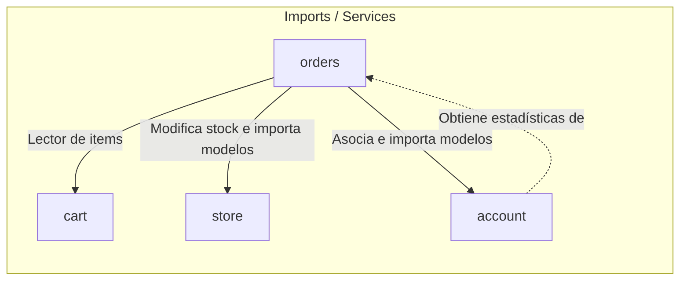

# 📦 Módulo Orders — Cerebro Local

> **Mapa neuronal:** **Relacionados:** [cart](../cart/README.md) · [store](../store/README.md) · [account](../account/README.md) · [tracking](../tracking/README.md)

## 🎯 Propósito
Este módulo gestiona la creación de órdenes de compra, el procesamiento de pagos (tanto en pasarela digital como vía WhatsApp) y la deducción de inventarios en el momento de concretar la transacción.

## 🕸️ Grafo de Dependencias (Codebase Graph)

*   **Entidades dependientes de este módulo:** 
    *   [account](../account/README.md) (Requiere consultar órdenes del usuario para armar las estadísticas de su panel de control)
*   **Módulos requeridos por este módulo:** 
    *   [cart](../cart/README.md) (Requiere el contenido del carrito de compras para transformarlo en líneas de pedido)
    *   [store](../store/README.md) (Vincula a los productos y sus variaciones vendidas)
    *   [account](../account/README.md) (Vincula la orden y los pagos a la cuenta del usuario)

## 🛠️ Modelos Clave / Entidades (DB)
- **Order** (Hereda de `models.Model`): Modela la cabecera de una compra. Almacena el número de orden (`order_number` único con índice de BD `db_index=True`), modalidad de entrega (`delivery_type`: `pickup` / `shipping` / `unspecified`), identificación fiscal (`invoice_type`: `B` / `A` / `unspecified`, `doc_number` DNI o CUIT validado, `business_name` Razón Social), datos de facturación/envío (`state` con `max_length=10` compatible con CPA argentino), estado (`New`, `Accepted`, `Completed`, `Cancelled`), `order_total` (`DecimalField(max_digits=12, decimal_places=2)`), `payment` (FK) y evidencia legal de aceptación de términos (`terms_accepted_at`, `terms_version='2026-10'`, migración `0008`, Ley 24.240 y CCCN). Expone `full_name()`, `full_address()` (ramas explícitas para retiro, envío y órdenes históricas), `get_delivery_display_name()`, `get_invoice_display_name()`, `get_status_badge_class()`, `get_geo_summary()` y `get_voice_summary()`.
- **Payment** (Hereda de `models.Model`): Registra la transacción de cobro. Vincula el ID del pago remoto (`payment_id`), método de pago (`payment_method`), monto (`amount_id`) y estado (`status`).
- **OrderProduct** (Hereda de `models.Model`): Through model que representa cada producto individual comprado. Congela el precio de venta en `purchase_price` (`DecimalField(max_digits=12, decimal_places=2)`), mapea variaciones (`Variation`) asociadas y mantiene relación `user = ForeignKey(Account, on_delete=models.SET_NULL, null=True)` para preservar la integridad de facturación histórica al eliminar cuentas de usuario.
- **OrderRevocation** (Hereda de `models.Model`, migración `0009`): Modela solicitudes del Botón de Arrepentimiento (Art. 34 Ley 24.240, Disp. 954/2025 y 3/2026). Almacena `revocation_code` inmutable y único (`ARR-YYYYMMDD-XXXXXXXXXX`, `db_index=True`), `origin` (`web` / `whatsapp`), `customer_name`, `contact_method` (`whatsapp` / `email`), `contact_value`, `order_reference`, FK opcional `order` (`on_delete=SET_NULL`, `related_name='revocations'`), `details`, `exception_basis`, `exception_reason`, trazabilidad legal de 24hs (`acknowledgment_sent`, `acknowledgment_sent_at`, `acknowledgment_channel`, `acknowledged_by`, `measures_taken`, `measures_description`, `measures_taken_at`, `handled_by`, `contacted_at`), `status` (`pending`, `contacted`, `in_review`, `resolved`, `not_eligible_exception`, `cancelled`, `db_index=True`), `internal_notes` y `resolved_at`. Por minimización de datos, **no** persiste la IP del solicitante.

## ⚡ Servicios y Casos de Uso Críticos (services.py)
- **OrderService.create_order_from_cart**: Crea la cabecera de la orden (registrando `terms_accepted_at` y `terms_version='2026-10'`) y genera los `OrderProduct` correspondientes a partir del carrito con `Decimal`. Exige obligatoriamente `delivery_type in ('pickup', 'shipping')` e `invoice_type in ('B', 'A')` sin fallbacks silenciosos.
- **OrderService.generate_order_number**: Genera un código único de orden `YYYYMMDD{id}`.
- **PaymentService.process_payment**: Registra la aprobación del pago, marca la orden como completada (`is_ordered=True`), vincula el ID de transacción y descuenta el stock indicativo mediante `_decrement_stock_and_mark_ordered()`.
- **PaymentService.create_whatsapp_payment**: Registra un pago pendiente (`status='Pending'`, `payment_id='WA-{order_number}'`) con método `"WhatsApp"` sin marcar prematuramente la orden como completada.
- **CheckoutService.complete_checkout**: Orquesta el checkout atómico (`@transaction.atomic`): bloquea y materializa los ítems activos con `CartItem.objects.select_for_update()`, rechaza ítems con `purchase_price is None` o `<= 0`, invoca `OrderService.create_order_from_cart` y elimina los `CartItem` del usuario en la misma transacción. (`send_order_confirmation_email` envía el correo cuando el flujo lo invoca).
- **WhatsAppService.process_whatsapp_order**: Procesa transaccionalmente (`@transaction.atomic`) la confirmación del pedido para WhatsApp: genera el pago, descuenta stock indicativo y marca `is_ordered=True` de manera indivisible.
- **WhatsAppService.generate_order_message**: Genera el mensaje estructurado para WhatsApp integrando la modalidad de entrega (Retiro en Mostrador en Av. Alvear 1301 vs. Envío al interior/NEA con nota aclaratoria de flete a convenir) y los datos fiscales (Factura A con CUIT y Razón Social vs. Factura B con DNI). Soporta órdenes históricas con etiqueta `(Orden histórica pre-digitalización)`.
- **WhatsAppService.generate_whatsapp_link**: Construye el enlace hacia `settings.WHATSAPP_NUMBER` con el mensaje codificado.
- **RevocationService**: Gestiona solicitudes de arrepentimiento: `check_rate_limit` (umbral volátil en Redis `orders:revocation:rate_limit:{ip}`, default `15/h`, sin persistir IP en BD), `generate_revocation_code` (`ARR-YYYYMMDD-...`), `_persist_with_unique_code` (hasta 5 reintentos ante `IntegrityError`) y `create_revocation` (`@transaction.atomic`, marca `acknowledgment_sent=True` inmediato en canal `web` y encola alerta interna `orders.tasks.send_revocation_notification_task` vía `transaction.on_commit()`).

## 📝 Notas de Detalle (Obsidian Vault)
- **Checkout CRO & Modalidades Comerciales (Fase 4A - Octubre 2026)**:
  - **Retiro en Mostrador sin Fricción**: Selector visual dual accesible con `<input type="radio">` nativos estilizados y accesibilidad ARIA (`role="radiogroup"`). Si el cliente elige Retiro, los campos de dirección se colapsan y no son obligatorios, eliminando más del 60% de fricción en compras locales.
  - **Cero Fallbacks Silenciosos**: Tanto en el formulario (`OrderForm`) como en el servicio (`OrderService.create_order_from_cart`) y plantillas, las modalidades son obligatorias y arrancan deseleccionadas (`initial=None`), rechazando cualquier sustitución automática por omisión.
  - **Identificación Fiscal Pragmática**: Selector Factura B (Consumidor Final) vs. Factura A (Responsable Inscripto). Validador matemático canónico de CUIT argentino (Algoritmo Módulo 11 en `orders/utils.py`) con contrato ASCII estricto (`isascii()`, `[0-9]`, `fullmatch()` y rechazo explícito de caracteres de control `\r\n\t` o dígitos Unicode).
  - **Claridad Logística en Flete**: En envíos NEA / Interior se especifica transparentemente tanto en checkout como en WhatsApp y órdenes completadas que el flete se coordina con el transporte y se abona en destino (no incluido en el total online).
  - **Tratamiento Explícito de Órdenes Históricas**: Clasificación en migración `0007` irreversible (`RunPython(..., reverse_code=None)`) a `unspecified`, con branch defensivo en `Order.full_address()`, administración y plantillas.
  - **Sincronización en WhatsApp**: La orden formateada viaja directamente al chat de atención de la empresa con todos los datos fiscales y logísticos especificados.
- **Botón de Arrepentimiento (`/orders/arrepentimiento/`)**: Vista pública `arrepentimiento_view` accesible sin autenticación ni registro previo; `OrderRevocationForm` incluye trampa honeypot (`website`) y validación según canal (`email` vs `whatsapp`). En Admin, `OrderRevocationAdminForm` exige descripción operativa cuando `measures_taken=True` y causal/fundamento cuando `status == 'not_eligible_exception'`, mientras `OrderRevocationAdmin.save_model()` autogenera código, operador y timestamps de acuse/medidas.
- **Tracking Híbrido de Compra (CAPI + GA4/Pixel)**: En POST válido, `place_order` exige el checkbox `accept_terms`, encola `MetaCapiService.enqueue_purchase(order, request)` y guarda `request.session['ba_pending_purchase'] = order.order_number`. Al aterrizar en `whatsapp_redirect`, la sesión se consume con `.pop()` para exponer `meta_payload` y `ga4_payload` vía `json_script` (ADR-04) evitando disparos duplicados al recargar.
- **Atomicidad Transaccional e Inventarios (AUD-ORD-NEW-001)**: `process_payment` y `process_whatsapp_order` corren bajo `@transaction.atomic`. Se eliminó la ventana de inconsistencia donde `is_ordered=True` se marcaba antes de descontar stock. Ambos flujos comparten la lógica centralizada en `_decrement_stock_and_mark_ordered()`.
- **Seguridad y Hardening (AppSec - Fase 21)**:
  - **Cierre de IDOR en Confirmación (AUD-201)**: `order_complete` y `order_detail` exigen autenticación y filtran por `user=request.user`, impidiendo visualizar órdenes y PII ajenas.
  - **Restricción de Pagos en API (AUD-202)**: En `OrderViewSet`, las acciones `process_payment` y `process_whatsapp` están restringidas a staff (`IsAdminUser`), impidiendo auto-aprobación no autorizada de pedidos.
  - **Bloqueo de Mutación GET en Pagos (AUD-203)**: La vista web `payments` exige `@require_POST`. Se eliminó la rama `GET ?whatsapp=true` y se solucionó el bug `TypeError` en redirección.
  - **Eliminación de Código Zombi (AUD-210)**: Depurado el template roto `templates/orders/payments.html` (payload desincronizado con el backend).
  - **Preservación Contable (AUD-ORD-NEW-002)**: `OrderProduct.user` configurado con `on_delete=SET_NULL, null=True` para permitir eliminación de cuentas spam sin borrar el detalle de facturas comerciales.
  - **Compatibilidad CPA (AUD-ORD-NEW-004)**: Campo `state` armonizado a `max_length=10` en modelo y serializer, soportando tanto códigos postales tradicionales de 4 dígitos como el Código Postal Argentino (CPA) alfanumérico de 8 caracteres (ej: `C1024AAA`).
- **Suite de Pruebas**: Cobertura en `orders/tests/` (`test_models.py`, `test_utils.py`, `test_services.py`, `test_checkout_modalities.py`, `test_web.py`, `test_api.py`, `test_tasks.py`) cubriendo modelos, validadores de CUIT/DNI, modalidades de entrega y facturación, branching de `Order.full_address()`, Botón de Arrepentimiento, servicios, API REST y vistas web (incluyendo control IDOR, métodos HTTP y `noindex` SEO).
