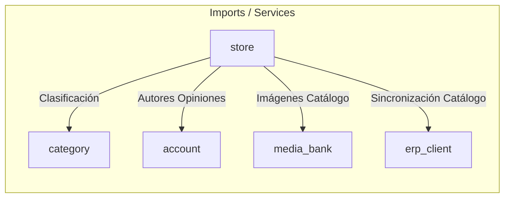

# 📦 Módulo Store — Cerebro Local

> **Mapa neuronal:** **Relacionados:** [category](../category/README.md) · [media_bank](../media_bank/README.md) · [cart](../cart/README.md) · [orders](../orders/README.md) · [tracking](../tracking/README.md)

## 🎯 Propósito
Este módulo constituye el núcleo de la tienda online: administra el catálogo completo de productos, las variaciones del catálogo (medidas, roscas, durezas), las opiniones y valoraciones de clientes (`reviews`), el centro de ayuda de preguntas frecuentes (`FAQs`), el motor de búsquedas semánticas y el generador dinámico de secciones de la página principal (`Home Page Builder V2`).

## 🕸️ Grafo de Dependencias (Codebase Graph)

*   **Entidades dependientes de este módulo:** 
    *   [cart](../cart/README.md) (CartItem contiene FK a Product y M2M a Variation)
    *   [orders](../orders/README.md) (OrderProduct contiene FK a Product y M2M a Variation)
    *   [blog](../blog/README.md) (Permite asociar productos sugeridos a los artículos)
*   **Módulos requeridos por este módulo:** 
    *   [category](../category/README.md) (Clasifica jerárquicamente los productos en categorías y subcategorías)
    *   [account](../account/README.md) (Vincula autores en las opiniones de productos)
    *   [media_bank](../media_bank/README.md) (ImageAsset actúa como origen de imágenes principal)
    *   [erp_client](../erp_client/README.md) (Permite sincronizar y actualizar el stock y precios del catálogo)

## 🛠️ Modelos Clave / Entidades (DB)
- **Product** (Hereda de `models.Model`): Modela el producto físico. Almacena SKU/código (`code`), dimensiones técnicas (`diameter`, `length`), especificaciones (`norm`, `grade`, `material`, `colour`, `type`, `form`, `thread_formats`, `origin`), campos de cross-selling (`related_subcategories` M2M a `SubCategory`, `diameter_relation`, `thread_formats_relation` y campos normalizados indexados `diameter_nominal`, `thread_pitch`, `thread_normalized` actualizados en `save()`), precios (`price`, `is_on_sale`, `sale_price`, `discount_percentage`), alícuota opcional (`tax_rate` como `DecimalField` para IVA `21.00%`, `10.50%`, `0.00%`), stock, SEO tags, FK `image` a `media_bank.ImageAsset` (más legacy `images` validado), M2M a `SubCategory` y `ProductTag`, y metadatos publicitarios (`brand`, `condition`, `gtin`, `mpn`, `google_category`). Expone propiedades comerciales e impositivas (`effective_price`, `effective_tax_rate` con default `Decimal('21.00')`, `price_without_taxes`, `sale_price_without_taxes`, `effective_price_without_taxes` vía `PricingService`, `has_valid_price`, `has_valid_image` validando storage físico vía `_stored_file_exists`, `image_url`, `webp_image_url`), helpers de feeds (`get_meta_pixel_data()`, `get_merchant_data()` con hasta 10 `additional_image_links` desde `ProductGallery`), `get_structured_properties()` (JSON-LD), gestión dimensional (`get_dimension_variants()`, `get_available_dimensions()`, `get_base_name()`), Smart Slug Regeneration (`_should_regenerate_slug()`, `_generate_unique_slug()`) y guarda `_skip_image_task` / `update_fields` en `save()`.
- **ProductTag** (Hereda de `models.Model`): Modela etiquetas o agrupadores de productos para filtrado rápido por características especiales o promocionales (ej. "CyberMonday", "Oferta", "Inoxidable"), con `name`, `slug` y estado `is_active`.
- **ProductGallery** (Hereda de `models.Model`): Galería secundaria del producto con FK `image_asset` (`media_bank.ImageAsset`), fallback legacy `image` validado y autocompletado de `alt` en `save()`.
- **Variation** (Hereda de `models.Model`): Opciones seleccionables por atributo según `variation_category_choise` (`color`, `talla`), gestionadas mediante `VariationManager` (`color()`, `tallas()`). Los atributos técnicos industriales (rosca, material, diámetro, largo) residen en campos dedicados de `Product`.
- **ReviewRating** (Hereda de `models.Model`): Modela las reseñas y puntuaciones de usuarios.
- **ProductSearch**, **SearchQuery** y **SearchQueryDaily** (Heredan de `models.Model`): `ProductSearch` rastrea productos encontrados para tendencias (`HomeSectionService`) con `unique_together` sobre `('product', 'user')` y `('product', 'session_key')`; `SearchQuery` centraliza términos buscados agregados (con y sin resultados) con `search_count`, `matched_count`, `unmatched_count`, `last_results_count` (indexado) y propiedad `has_results`, aplicando heurística anti-PII y descarte de bots sin persistir IPs, usuarios ni sesiones; `SearchQueryDaily` agrega métricas diarias por término (`UniqueConstraint` sobre `('search_query', 'date')`) para rankear consultas por ventana temporal (7/30/90 días o histórico).
- **FAQ** y **FAQCategory** (Hereda de `models.Model`): Estructura las preguntas frecuentes del catálogo con FK opcional `subcategory` (`category.SubCategory`, `related_name='faqs'`).
- **HomeSection**, **HomeSectionProduct** y **PromoBanner**: Tablas del *Home Page Builder V2* (`12` `SECTION_TYPES`, `8` `SOURCE_TYPES`, propiedad `has_manual_products`, orden `position`, `cta_text`, `highlight_color`). `PromoBanner` soporta Art Direction multi-breakpoint (`image_desktop_asset`, `image_mobile_asset`, `image_tablet_asset`, `image_large_asset` más fallbacks legacy) y resolución de enlace `get_link_url()` por prioridad `url > link_product > link_category + link_params`.
- **CarouselImage**: Banners principales del carrusel con `show_title`, soporte Art Direction multi-breakpoint (`image_asset`, `image_mobile_asset`, `image_tablet_asset`, `image_large_asset`), enlaces opcionales (`url`, `product`) y tarea Celery `process_carousel_image` sobre el campo legacy `image`.

## ⚡ Servicios y Casos de Uso Críticos (services.py)
- **PricingService.calculate_net_price**: Calcula el importe neto sin impuestos nacionales indirectos a partir de un precio bruto final y una alícuota porcentual (por defecto `21.00%` según `DEFAULT_TAX_RATE`), aplicando la fórmula `neto = bruto / (1 + tasa / 100)` con redondeo financiero canónico `ROUND_HALF_UP` a 2 decimales para dar cumplimiento a la Resolución 4/2025.
- **ProductService.filter_products / get_paginated_products**: Filtra y pagina (`per_page=30`) productos del catálogo usando `paginator.count` (`SELECT COUNT(*)`) para evitar materializar `QuerySet` completos en memoria. Soporta filtrado multi-tag con semántica AND estricta mediante subconsultas (`pk__in`), y en `store:search` se combina con ordenamiento `sort_by` (`price_asc`/`price_desc`) y el template tag `query_with_page` (preserva parámetros multi-valor como `?tags=a&tags=b`, evita duplicar `page=` y escapa fracciones/espacios).
- **ProductService.get_available_tags**: Obtiene tags activos vinculados a productos disponibles para alimentar los filtros de la barra lateral.
- **ProductService.generate_import_template_workbook**: Genera en memoria (`io.BytesIO`) con openpyxl la plantilla oficial de Excel (`.xlsx`) para importación masiva de productos (`mode='full'`) con 33 columnas canónicas estilizadas por código cromático corporativo, paneles inmovilizados, validaciones desplegables (`condition`, `tax_rate`), formato texto `@` en códigos, dimensiones y `diameter_relation` para prevenir corrupción de datos en Excel, y 2 hojas de documentación integrada (*Guía y Ejemplos* con 3 casos reales ferreteros y *Guía de Imágenes*). Soporta también `mode='prices'` para actualización rápida de precios (2 columnas: `code` y `price`).
- **ProductService.export_products_workbook**: Exporta el catálogo completo o filtrado por categoría, subcategoría, disponibilidad o selección del Admin en un archivo Excel (`.xlsx`) 100% compatible round-trip con la plantilla oficial de importación (33 columnas y 3 hojas). Implementado con `openpyxl.Workbook(write_only=True)`, volcado a `SpooledTemporaryFile` y pre-carga relacional O(1) en 6 consultas fijas (`subcategories`, `related_subcategories`, `tags`, galería, FAQs y `.values().iterator(chunk_size=1000)`) para mantener consumo plano de RAM (`< 20 MB`) y evitar timeouts o errores HTTP 500 en catálogos de +14.000 productos.
- **RelatedProductService.get_related_products**: Motor de cross-selling técnico para la ficha de producto (`/store/p/<slug>/`). Aplica **Opción C** (match indexado por `diameter_nominal` + familia/paso de rosca sin excluir candidatos sin rosca como arandelas, omitiendo la subcategoría si no hay stock compatible) cuando existen `diameter_relation` o `thread_formats_relation`, y **Opción B** (mejores disponibles de la subcategoría relacionada por material/ventas) cuando ambos están vacíos. Cachea resultados en Redis (`store:related_products:v1:<id>`, TTL 15 min) con hidratación fresca anti-stale e invalidación automática vía `store/signals.py`.
- **ProductService.start_bulk_upload_session / process_bulk_upload_chunk / cancel_bulk_upload_session**: Arquitectura de procesamiento masivo fraccionado en lotes HTTP secuenciales (`IMPORT_CHUNK_SIZE=250`, `PRICES_CHUNK_SIZE=500`) con compresión `zlib` en memoria caché (`django-redis`), propagación opcional de `preserve_existing_stock` en metadatos de sesión para proteger el stock web al curar subcategorías, idempotencia ante microcortes de red, optimización con `bulk_update` en precios y telemetría de progreso en tiempo real (barra, spinner y porcentaje), eliminando timeouts de proxy (60s OLS / 120s uWSGI) en catálogos de 10.000 a 14.000+ filas.
- **ProductService.import_from_file / _sanitize_stock**: Lee y analiza archivos Excel/CSV utilizando pandas, descarta filas 100% vacías defensivamente, centraliza la importación de productos, imágenes, categorías y relaciones técnicas (`related_subcategories` con alias `ProductRelation` sin crear subcategorías fantasma, `diameter_relation`, `thread_formats_relation`, preservando con vacío y limpiando con `'-'`), procesa `stock` de forma no destructiva (celdas vacías o columna ausente conservan el stock actual en productos existentes e inicializan `0` solo en altas nuevas; `_sanitize_stock` valida enteros y `.0`/`,00` rechazando separadores de miles ambiguos como `"1.000"`, fracciones o texto con rollback por fila; soporta `preserve_existing_stock` / `--preserve-stock` en CLI y delega `update_prices=True` en `update_prices_from_file`), procesa la columna opcional `tax_rate` para alícuotas personalizadas (con fallback a `21.00`), y procesa la columna `tags` (creando automáticamente tags inexistentes o reutilizando existentes sin duplicación).
- **SearchService.search_products**: Implementa búsquedas de productos en código, nombre, descripción, marca, categoría y subcategorías con deduplicación `.distinct()`.
- **SearchService.record_search_query / record_unmatched_search**: Registra atómicamente (`F() + 1` con defensa ante `IntegrityError`) consultas con y sin resultados en `SearchQuery` y `SearchQueryDaily` únicamente en página 1 inicial (sin paginación ni `sort_by`). Descarta User-Agents de bots/previews (`is_bot_user_agent`), aplica filtro heurístico anti-PII sobre el texto completo antes de truncar a 100 caracteres, extrae la IP del último salto de `X-Forwarded-For` (`extract_telemetry_client_ip` para evitar spoofing delante de OpenLiteSpeed) y la hashea con `SHA-256 + SECRET_KEY` en Redis para aplicar rate-limiting *fail-closed* de 2 niveles (`30` escrituras/min por IP bloqueando también `ProductSearch`, `15` términos nuevos/10 min por IP y circuit-breaker global de `120` términos nuevos/10 min), sin devolver `429` ni interrumpir el catálogo `200 OK` y con higiene estricta de logs. `record_unmatched_search` se conserva como wrapper retrocompatible.
- **SearchService.apply_period_ranking / export_search_queries_workbook**: Anota consultas por ventana temporal (`DEFAULT_EXPORT_PERIOD_DAYS = 90`, soportando `7`, `30`, `90` y `all`) y exporta en streaming (`openpyxl.Workbook(write_only=True)` + `SpooledTemporaryFile`) un archivo Excel de 2 hojas (`Ranking` con autofiltro, formato texto `@` y defensa anti-*Formula Injection* `CWE-1236`, y `Resumen` con KPIs). Expuesto en `SearchQueryAdmin` vía botón *"Exportar a Excel (.xlsx)"* (respetando filtros activos del `ChangeList`) y acción masiva sobre seleccionados.
- **ReviewService.create_review**: Gestiona el guardado y actualización de reviews recalculando la media de estrellas del producto.
- **HomeSectionService.get_active_sections**: Obtiene las secciones del Home y resuelve las consultas específicas de sus productos asociados (respetando curaduría manual o fallback automático).
- **GoogleReviewsService**: Consulta e integra calificaciones externas desde la API oficial de Google Maps con almacenamiento en caché de Redis.

## 📝 Notas de Detalle (Obsidian Vault)
- **Cumplimiento Legal y Transparencia de Precios (Resolución 4/2025 - Fase 5)**:
  - Todas las superficies de catálogo (tarjetas de productos, carruseles, modales de vista rápida, fichas de detalle) desglosan debajo del precio final el valor sin impuestos nacionales con la leyenda estricta `"PRECIO SIN IMPUESTOS NACIONALES: $... "`.
  - Soporte de cálculo dinámico configurable mediante `Product.tax_rate` y fallback general a `21.00%`.
  - Suite de auditoría legal y financiera dedicada: `store/tests/test_pricing_and_legal_audit.py` (14 tests verificando fórmulas, redondeos, tags de template, importador y filtros).
- **Carga Masiva por Lotes y Barra de Progreso en Tiempo Real (Chunking)**:
  - Endpoints administrativos seguros en `ProductAdmin`: `/admin/store/product/bulk-upload/start/`, `/bulk-upload/chunk/` y `/bulk-upload/cancel/` protegidos con verificación de permisos de modelo y aislamiento de sesión anti-IDOR (`user_id`).
  - Optimización ORM por lote: `bulk_update` en actualizaciones de precios con recálculo automático de descuentos en oferta, y guarda defensiva en `Product.save()` que suprime encolamientos espurios a Celery (`process_product_image.delay`) cuando no se altera la fotografía.
  - UI reactiva en `import_products.html` y `update_prices.html`: spinner circular animado, barra fluida con porcentaje accesible (`role="progressbar"`), contadores en vivo (procesados, creados, actualizados, errores), log desplegable de errores y guarda `beforeunload` para prevenir cierres involuntarios de pestaña.
  - Cobertura en `store/tests/test_import.py`: validando particionamiento, round-trip, `bulk_update`, idempotencia, cancelaciones, seguridad IDOR, preservación de `stock` en celdas vacías/ausentes, validación `_sanitize_stock` y propagación de `preserve_existing_stock`.
- **Descarga de Plantilla Excel Oficial en Django Admin**:
  - Endpoint administrativo seguro `/admin/store/product/download-import-template/` (`ProductAdmin.download_import_template`) con verificación de permisos `add_product`/`change_product`.
  - Integración en la interfaz de administración: botón en `change_list.html`, tarjeta destacada e instrucciones corregidas en `import_products.html` y botón rápido en `update_prices.html`.
  - Suite de importación y plantillas en `store/tests/test_import.py`: 24 tests unitarios, round-trip y de permisos en admin.
- **Algoritmo de Regeneración de Slugs**: Los productos importados reciben slugs temporales automáticos. El sistema detecta cuando el nombre ha sido curado profesionalmente por un operario para gatillar la regeneración limpia y definitiva del slug.
- **Seguridad y Hardening (AppSec - Fase 19)**:
  - **BOLA en Reseñas (SEC-101)**: `submit_review` verifica `ReviewService.user_can_review()`, prohibiendo que usuarios califiquen productos sin haberlos comprado previamente.
  - **Open Redirect (SEC-102)**: Redirecciones seguras con `url_has_allowed_host_and_scheme(allowed_hosts={request.get_host()})` y fallback a `store:store`.
  - **Fuga de Información en Feeds (SEC-104 & SEC-105)**: Respuestas de error genéricas (status 500) en feeds web y API sin filtrar excepciones internas.
  - **Paginación Defensiva (SEC-106) & Anti-DoS en Búsqueda (SEC-109)**: Paginación estructurada en `SearchViewSet` y truncamiento estricto a 100 caracteres en keywords de búsqueda.
  - **Optimización Anti N+1 (SEC-107)**: `ProductViewSet` y `SearchViewSet` anotan promedio y conteo de reseñas en DB, priorizados por serializers.
  - **Eficiencia de Memoria en Feeds (SEC-111 & SEC-112)**: Consumo con `.iterator(chunk_size=200)` y unificación a través de `FeedService`.
  - **Suite de Seguridad**: 9 tests específicos en `store/tests/test_security.py`.
- **Productos Relacionados y Cross-Selling Técnico (Fase 1)**:
  - **Campos en `Product`:** `related_subcategories` (`ManyToManyField` a `category.SubCategory`, `related_name='recommended_for_products'`), `diameter_relation`, `thread_formats_relation`, y campos indexados no editables `diameter_nominal`, `thread_pitch` y `thread_normalized` (migración de esquema `0023` + backfill en lotes con `bulk_update` en `0024` sin invocar `Product.save()`).
  - **Normalizador Puro (`store/relation_utils.py`):** `parse_diameter_and_pitch`, `normalize_thread_format` y `COMPATIBLE_THREAD_FAMILIES`, calibrados sobre los 103 valores de `diameter` y 12 de `thread_formats` del catálogo (incluyendo pasos milimétricos `P`, TPI `H`, equivalencias en paréntesis y mangueras `AxB` sin separar).
  - **Motor (`RelatedProductService.get_related_products`):** Aplica **Opción C** (match indexado por diámetro + familia/paso de rosca sin excluir candidatos sin rosca como arandelas, omitiendo la subcategoría ante falta de stock compatible) cuando hay criterios en `*_relation`, u **Opción B** (mejores disponibles de la subcategoría por material/ventas) cuando ambos están vacíos. Reparto round-robin, caché Redis `store:related_products:v1:<id>` (TTL 15 min) con hidratación fresca anti-stale e invalidación vía `store/signals.py` (`StoreConfig.ready()`).
  - **Exposición UI y Tests:** Bloque **"Completá tu compra"** al pie de la sección Descripción en `templates/store/product_detail.html` (`partials/_related_product_card.html`), cumplimiento **Res. 4/2025**, botón rápido "+ Agregar" con tracking `code`/`effective_price`, JSON-LD `isRelatedTo` y suite `store/tests/test_related_products.py`.

