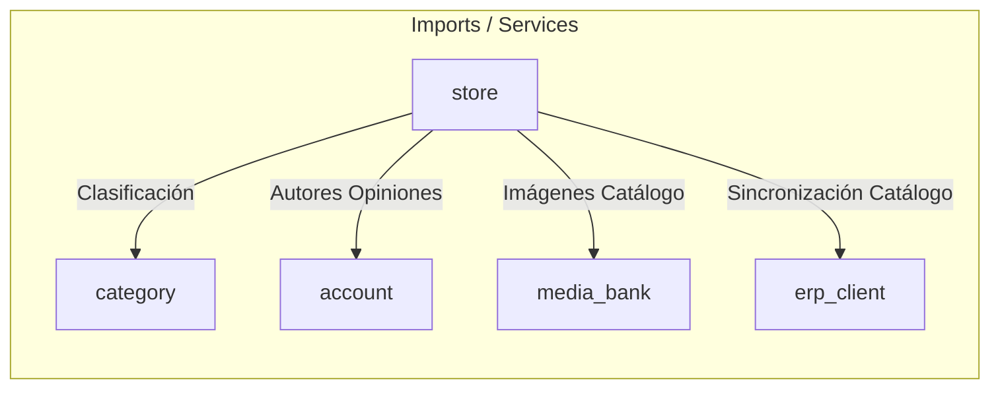

# 📦 Módulo Store — Cerebro Local

## 🎯 Propósito
Este módulo constituye el núcleo de la tienda online: administra el catálogo completo de productos, las variaciones del catálogo (medidas, roscas, durezas), las opiniones y valoraciones de clientes (`reviews`), el centro de ayuda de preguntas frecuentes (`FAQs`), el motor de búsquedas semánticas y el generador dinámico de secciones de la página principal (`Home Page Builder V2`).

## 🕸️ Grafo de Dependencias (Codebase Graph)

*   **Entidades dependientes de este módulo:** 
    *   [cart](../cart/README.md) (CartItem contiene FK a Product y M2M a Variation)
    *   [orders](../orders/README.md) (OrderProduct contiene FK a Product y M2M a Variation)
    *   [blog](../blog/README.md) (Permite asociar productos sugeridos a los artículos)
*   **Módulos requeridos por este módulo:** 
    *   [category](../category/README.md) (Clasifica jerárquicamente los productos en categorías y subcategorías)
    *   [account](../account/README.md) (Vincula autores en las opiniones de productos)
    *   [media_bank](../media_bank/README.md) (ImageAsset actúa como origen de imágenes principal)
    *   [erp_client](../erp_client/README.md) (Permite sincronizar y actualizar el stock y precios del catálogo)

## 🛠️ Modelos Clave / Entidades (DB)
- **Product** (Hereda de `models.Model`): Modela el producto físico. Almacena código de barras/código interno (`code`), medidas (`diameter`, `length`), precios (estándar y en oferta), alícuota impositiva opcional (`tax_rate` como `DecimalField` para IVA 21%, 10.5%, etc.), stock, SEO tags, relación M2M a `ProductTag` y metadatos para integración publicitaria en redes (Meta Pixel y Google Merchant Feed). Expone propiedades calculadas para el precio neto sin impuestos nacionales (`price_without_taxes`, `sale_price_without_taxes`, `effective_price_without_taxes`) conforme a la Resolución 4/2025.
- **ProductTag** (Hereda de `models.Model`): Modela etiquetas o agrupadores de productos para filtrado rápido por características especiales o promocionales (ej. "CyberMonday", "Oferta", "Inoxidable"), con `name`, `slug` y estado `is_active`.
- **ProductGallery** (Hereda de `models.Model`): Colección de imágenes adicionales para el producto.
- **Variation** (Hereda de `models.Model`): Mapea opciones del producto por categorías (ej. Rosca, Material, Medida).
- **ReviewRating** (Hereda de `models.Model`): Modela las reseñas y puntuaciones de usuarios.
- **ProductSearch** y **SearchQuery** (Heredan de `models.Model`): `ProductSearch` rastrea productos encontrados para tendencias; `SearchQuery` registra términos sin resultados (demanda oculta) de forma agregada para decisiones de compras y stock. Aplica una heurística de reducción de riesgo anti-PII (omitiendo emails, teléfonos y DNI/CUIT sin garantizar ausencia total en texto libre) y mide volumen acumulado de solicitudes (`search_count`), sin persistir IPs, usuarios ni sesiones.
- **FAQ** y **FAQCategory** (Hereda de `models.Model`): Estructura las preguntas frecuentes a nivel de catálogo.
- **HomeSection**, **HomeSectionProduct** y **PromoBanner**: Tablas de configuración del *Home Page Builder V2* que permiten estructurar carruseles, accesos rápidos y grids promocionales desde el admin.
- **CarouselImage**: Banners principales del carrusel de bienvenida.

## ⚡ Servicios y Casos de Uso Críticos (services.py)
- **PricingService.calculate_net_price**: Calcula el importe neto sin impuestos nacionales indirectos a partir de un precio bruto final y una alícuota porcentual (por defecto `21.00%` según `DEFAULT_TAX_RATE`), aplicando la fórmula `neto = bruto / (1 + tasa / 100)` con redondeo financiero canónico `ROUND_HALF_UP` a 2 decimales para dar cumplimiento a la Resolución 4/2025.
- **ProductService.filter_products / paginate_products**: Filtra y pagina productos en el catálogo; soporta filtrado multi-tag con semántica AND estricta mediante subconsultas (`pk__in`) para evitar producto cartesiano en anotaciones de reviews.
- **ProductService.get_available_tags**: Obtiene tags activos vinculados a productos disponibles para alimentar los filtros de la barra lateral.
- **ProductService.generate_import_template_workbook**: Genera en memoria (`io.BytesIO`) con openpyxl la plantilla oficial de Excel (`.xlsx`) para importación masiva de productos (`mode='full'`) con 30 columnas canónicas estilizadas por código cromático corporativo, paneles inmovilizados, validaciones desplegables (`condition`, `tax_rate`), formato texto `@` en códigos y dimensiones para prevenir corrupción de datos en Excel, y 2 hojas de documentación integrada (*Guía y Ejemplos* con 3 casos reales ferreteros y *Guía de Imágenes*). Soporta también `mode='prices'` para actualización rápida de precios (2 columnas: `code` y `price`).
- **ProductService.start_bulk_upload_session / process_bulk_upload_chunk / cancel_bulk_upload_session**: Arquitectura de procesamiento masivo fraccionado en lotes HTTP secuenciales (`IMPORT_CHUNK_SIZE=250`, `PRICES_CHUNK_SIZE=500`) con compresión `zlib` en memoria caché (`django-redis`), idempotencia ante microcortes de red, optimización con `bulk_update` en precios y telemetría de progreso en tiempo real (barra, spinner y porcentaje), eliminando timeouts de proxy (60s OLS / 120s uWSGI) en catálogos de 10.000 a 14.000+ filas.
- **ProductService.import_from_file**: Lee y analiza archivos Excel/CSV utilizando pandas, descarta filas 100% vacías defensivamente, centraliza la importación de productos, imágenes y categorías, procesa la columna opcional `tax_rate` para alícuotas personalizadas (con fallback a `21.00`), y procesa la columna `tags` (creando automáticamente tags inexistentes o reutilizando existentes sin duplicación).
- **SearchService.search_products**: Implementa búsquedas de productos en código, nombre, descripción, marca, categoría y subcategorías con deduplicación `.distinct()`.
- **SearchService.record_unmatched_search**: Registra e incrementa conteos de solicitudes de búsqueda sin resultados en `SearchQuery` aplicando filtro heurístico por patrones (emails, teléfonos, documentos) e higiene estricta de logs (sin volcar términos crudos).
- **ReviewService.create_review**: Gestiona el guardado y actualización de reviews recalculando la media de estrellas del producto.
- **HomeSectionService.get_active_sections**: Obtiene las secciones del Home y resuelve las consultas específicas de sus productos asociados (respetando curaduría manual o fallback automático).
- **GoogleReviewsService**: Consulta e integra calificaciones externas desde la API oficial de Google Maps con almacenamiento en caché de Redis.

## 📝 Notas de Detalle (Obsidian Vault)
- **Cumplimiento Legal y Transparencia de Precios (Resolución 4/2025 - Fase 5)**:
  - Todas las superficies de catálogo (tarjetas de productos, carruseles, modales de vista rápida, fichas de detalle) desglosan debajo del precio final el valor sin impuestos nacionales con la leyenda estricta `"PRECIO SIN IMPUESTOS NACIONALES: $... "`.
  - Soporte de cálculo dinámico configurable mediante `Product.tax_rate` y fallback general a `21.00%`.
  - Suite de auditoría legal y financiera dedicada: `store/tests/test_pricing_and_legal_audit.py` (14 tests verificando fórmulas, redondeos, tags de template, importador y filtros).
- **Carga Masiva por Lotes y Barra de Progreso en Tiempo Real (Chunking)**:
  - Endpoints administrativos seguros en `ProductAdmin`: `/admin/store/product/bulk-upload/start/`, `/bulk-upload/chunk/` y `/bulk-upload/cancel/` protegidos con verificación de permisos de modelo y aislamiento de sesión anti-IDOR (`user_id`).
  - Optimización ORM por lote: `bulk_update` en actualizaciones de precios con recálculo automático de descuentos en oferta, y guarda defensiva en `Product.save()` que suprime encolamientos espurios a Celery (`process_product_image.delay`) cuando no se altera la fotografía.
  - UI reactiva en `import_products.html` y `update_prices.html`: spinner circular animado, barra fluida con porcentaje accesible (`role="progressbar"`), contadores en vivo (procesados, creados, actualizados, errores), log desplegable de errores y guarda `beforeunload` para prevenir cierres involuntarios de pestaña.
  - Cobertura completa en `store/tests/test_import.py`: 34 tests automatizados validando particionamiento, round-trip, bulk_update, idempotencia, cancelaciones y seguridad IDOR.
- **Descarga de Plantilla Excel Oficial en Django Admin**:
  - Endpoint administrativo seguro `/admin/store/product/download-import-template/` (`ProductAdmin.download_import_template`) con verificación de permisos `add_product`/`change_product`.
  - Integración en la interfaz de administración: botón en `change_list.html`, tarjeta destacada e instrucciones corregidas en `import_products.html` y botón rápido en `update_prices.html`.
  - Suite de importación y plantillas en `store/tests/test_import.py`: 24 tests unitarios, round-trip y de permisos en admin.
- **Algoritmo de Regeneración de Slugs**: Los productos importados reciben slugs temporales automáticos. El sistema detecta cuando el nombre ha sido curado profesionalmente por un operario para gatillar la regeneración limpia y definitiva del slug.
- **Seguridad y Hardening (AppSec - Fase 19)**:
  - **BOLA en Reseñas (SEC-101)**: `submit_review` verifica `ReviewService.user_can_review()`, prohibiendo que usuarios califiquen productos sin haberlos comprado previamente.
  - **Open Redirect (SEC-102)**: Redirecciones seguras con `url_has_allowed_host_and_scheme(allowed_hosts={request.get_host()})` y fallback a `store:store`.
  - **Fuga de Información en Feeds (SEC-104 & SEC-105)**: Respuestas de error genéricas (status 500) en feeds web y API sin filtrar excepciones internas.
  - **Paginación Defensiva (SEC-106) & Anti-DoS en Búsqueda (SEC-109)**: Paginación estructurada en `SearchViewSet` y truncamiento estricto a 100 caracteres en keywords de búsqueda.
  - **Optimización Anti N+1 (SEC-107)**: `ProductViewSet` y `SearchViewSet` anotan promedio y conteo de reseñas en DB, priorizados por serializers.
  - **Eficiencia de Memoria en Feeds (SEC-111 & SEC-112)**: Consumo con `.iterator(chunk_size=200)` y unificación a través de `FeedService`.
  - **Suite de Seguridad**: 9 tests específicos en `store/tests/test_security.py`.

