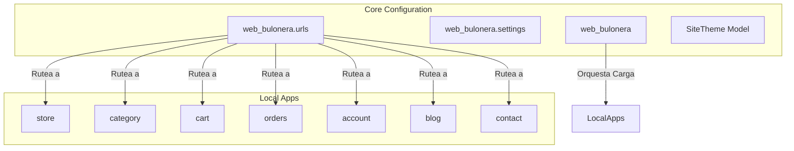

# 📦 Módulo web_bulonera — Cerebro Local

## 🎯 Propósito
Este módulo constituye el núcleo de configuración, ruteo general y orquestación del proyecto Django. Contiene los archivos de configuración (`settings/`), la configuración de tareas en segundo plano (`celery.py`), middlewares transversales, manejadores de errores y el modelo de tematización visual dinámica (`SiteTheme`).

## 🕸️ Grafo de Dependencias (Codebase Graph)

*   **Entidades dependientes de este módulo:** Todas las aplicaciones locales (heredan configuraciones del proyecto, settings de base de datos, caché y orquestación de URLs).
*   **Módulos requeridos por este módulo:** 
    *   [category](../category/README.md) (Se inyecta en context processors generales)
    *   [store](../store/README.md) (Se inyecta en el ruteo central e interactúa con el tema)

## 🛠️ Modelos Clave / Entidades (DB)
- **SiteTheme** (Hereda de `models.Model`): Modelo tipo Singleton (máximo una sola instancia en BD) que permite a los administradores ajustar en tiempo real el diseño y los colores del sitio (gamas cromáticas en HEX para botones, navbars, opacidades y fondos) desde el Panel de Administración de Django sin necesidad de redeploy.
- **BusinessHoursSetting** (Hereda de `models.Model`): Configuración centralizada tipo Singleton (método `BusinessHoursSetting.load()`) para los horarios comerciales de toda la plataforma. Fuente única de verdad consumida por vistas, templates y datos estructurados.
- **BusinessHoursPeriod** (Hereda de `models.Model`): Intervalos semanales de atención por día de la semana (`day` 1..7, `opening_time`, `closing_time`), permitiendo jornadas corridas o turnos partidos (ej. mañana y tarde).
- **BusinessHoursException** (Hereda de `models.Model`): Excepciones puntuales de calendario para feriados nacionales o jornadas especiales (`date`, `is_closed`, `opening_time`, `closing_time`, `reason`). Expone alertas del día actual y especificaciones `specialOpeningHoursSpecification` para Google / Schema.org.

## ⚡ Componentes Críticos y Context Processors
- **Settings Multi-Entorno (`settings/`)**:
  - `base.py`: Configuraciones compartidas del stack (Django, DRF, Celery, Redis, etc.).
  - `local.py`: Variables e instrumentación específicas de desarrollo.
  - `production.py`: Configuraciones de alta seguridad (SSL, cabeceras, tokens) para el servidor productivo VPS.
- **Context Processors (`context_processors.py`)**:
  - `meta_settings`: Inyecta automáticamente variables globales en los templates (e.g. `WHATSAPP_NUMBER`, `META_PIXEL_ID`, claves de Google Maps).
  - `site_theme`: Inyecta el tema activo de colores (`SiteTheme`) en todos los templates con almacenamiento en caché de Redis por 1 hora.
  - `business_hours`: Inyecta el horario comercial dinámico estructurado (`short`, `lines`, `schema_specifications_json`, `special_schema_specifications_json`, `today_exception`) en todas las plantillas.
- **Servicios Centrales (`business_hours.py`)**:
  - `get_business_hours_data()`: Obtiene y cachea (`business_hours_active`) la estructura horaria completa con recálculo automático al pasar la medianoche local (`America/Argentina/Buenos_Aires`).
- **Middlewares (`middleware.py`)**:
  - `ErrorLoggingMiddleware`: Captura y registra excepciones imprevistas en los logs del servidor.

## 📝 Notas de Detalle (Obsidian Vault)
- **Invalida Caché**: Cada vez que se actualiza el tema visual o el horario comercial en el panel de control, los métodos `save()` y `save_related()` purgan las claves `site_theme_active` y `business_hours_active` de Redis para aplicar los cambios de manera instantánea.
- **Administración 1-Clic de Horarios**: `BusinessHoursSettingAdmin` redirige el changelist directamente a la edición del Singleton e implementa `BusinessHoursPeriodInlineFormSet` para evitar solapamientos horarios en el mismo día.
- **Seguridad y Hardening (AppSec)**:
  - Cargas y exploración de archivos en CKEditor restringidas a `staff_member_required`. Subidas de archivos no-imagen bloqueadas (`CKEDITOR_ALLOW_NONIMAGE_FILES = False`).
  - Documentación de API (`/api/schema/` y `/api/docs/`) accesible únicamente para usuarios staff/admin (`IsAdminUser`).
  - Cabecera `SECURE_PROXY_SSL_HEADER` y cookies `SESSION_COOKIE_HTTPONLY`/`SESSION_COOKIE_SAMESITE='Lax'` en producción.
  - Servido de medios estáticos (`static()`) estrictamente condicionado a `DEBUG=True`.
  - Excepciones de middleware canalizadas al logger namespace `'django'`.

